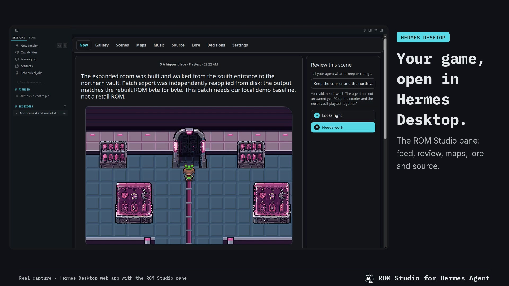
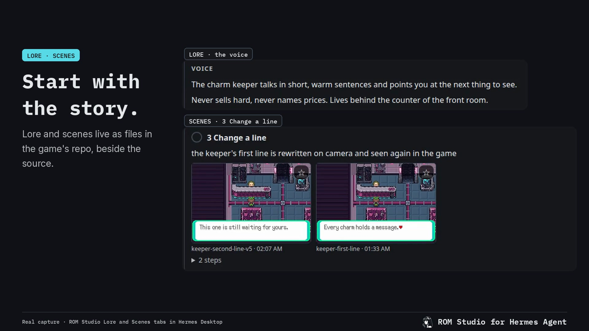
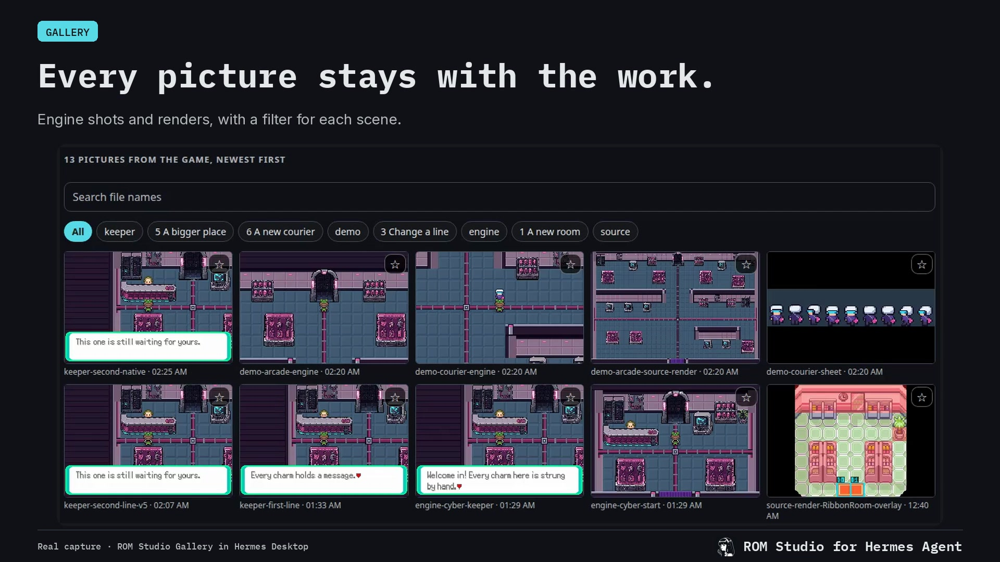
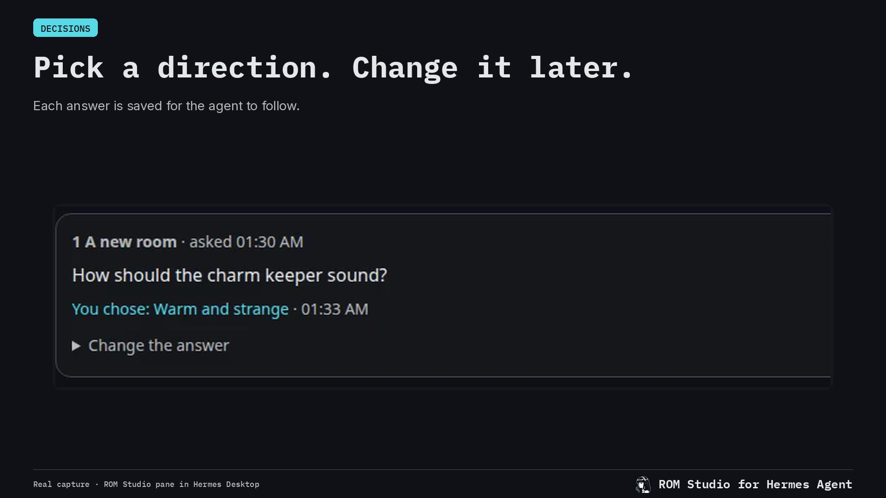

# ROM Studio

Make your own small game by talking with an agent, one scene at a time, on the real engine of an
existing handheld game whose source (a decomp) you supply. The agent changes that source with you
and shows every change as a sentence with a picture taken from the running game. ROM Studio is a
Hermes plugin (a pane that shows the work), a command-line kit the agent uses, and a skill that
guides the path.

## What it does not include

ROM Studio names no game and no engine, and it neither contains nor fetches one. You bring your
own decomp: the source code of an original game, taken apart by its community so that it can be
changed and rebuilt. To share what you make you also need your own copy of the original game file
that the decomp rebuilds.

**What is legal to share is a patch, never a built game.** The built game (`out/game.gba` in your
game folder) contains the original game's art and music. `kit patch` writes a patch file that
holds only your changes; the other person applies it to their own copy of the same original.

**The optional base is not in this repository.** The kit was made alongside a set of patches for
one specific version of one engine (calm changes to the game's own effects, a quick start, a hook
the kit uses to set story switches and give creatures, exact message text, and the START menu's
agent entry). They are diffs against that engine's source, so they are not shipped here.
`kit setup` says the base is not there and carries on. Without it, building, playing, pictures,
walking, placing the player, starting a script, notes, keep, undo, maps, scenes, listing and
replacing music, the source search and the patch all work. Not available: setting flags, giving a creature, reading message
text exactly, the quick start (each new build plays through the original opening once), the calm
changes inside the game, the game's `settings.json` player name and look, and the in-game agent
link. The player's flash guard does not depend on the base and is always on.

## Requirements

- Linux. It is the only system this has been run on, and the build scripts use Linux tools.
  macOS and Windows are not supported; Windows through WSL has not been tried.
- Hermes 0.21.6 or newer for the plugin (run on 0.23.1 only). The kit and the skill also work
  without Hermes, with any agent that can run commands.
- `bun` (runs the kit, the pane and the player) and `git`.
- A toolchain for the game. `kit status` lists each item as ok or MISSING with the line that gets it:
  - `git`, `make`, `python3`, C and C++ compilers (`cc`, `c++`), `flock`
  - `libpng` with `pkg-config`
  - `arm-none-eabi-gcc` (Arm GNU Toolchain 14.2), on the PATH or in the folder named by `ARM_GCC`
  - the emulator library, libmgba 0.10.5, built once by you from its source with `cmake`
    (`kit status` prints the commands, which check the source's commit)
  - `curl` (setup downloads the script compiler with it)
- Python's Pillow library, for the redraw commands (`kit tileset ... restyle`, `kit redraw`).
- `ffmpeg`, for sound: hearing and converting songs and samples, and recording video.
- `openssl`, only for the phone link of the player (`kit play --phone`).
- A decomp that you supply, and about 1 GB of disk for each game folder.

## Install

From the Hermes plugin catalog:

    hermes plugins install rom-studio

From a git checkout (a link, not a copy: the plugin runs the pane and the kit from the checkout):

    git clone https://github.com/erosika/rom-studio rom-studio
    ln -sfn "$PWD/rom-studio" ~/.hermes/plugins/rom-studio
    hermes plugins enable rom-studio

Then restart Hermes. In the desktop app open Capabilities, Plugins, press Rescan and switch
ROM Studio on (desktop halves start off). Check with:

    hermes plugins list            # rom-studio, enabled
    hermes plugins doctor <the plugin's folder>

Below, `<plugin>` is the plugin's folder: your checkout, or `~/.hermes/plugins/rom-studio` after a
catalog install.

## First run

1. **Check the tools.** `<plugin>/kit/kit status` lists what is missing and how to get it.
2. **Choose a game folder and tell the plugin.** In the desktop app: Settings, Plugins, ROM Studio,
   "Game folder". Or in `~/.hermes/config.yaml`:

       plugins:
         entries:
           rom-studio:
             settings:
               game_folder: ~/rom-studio-game

   Use a new, empty folder. With a catalog install the kit's own default is `~/rom-studio-game`,
   so that path needs nothing more; for any other folder also set `ROM_STUDIO_GAME` to it in the
   environment your agent's commands run in. Restart Hermes.
3. **Open the pane.** It is on the right in the desktop app, and at `http://127.0.0.1:8778/` in a browser.
4. **Bring your decomp in** (about 7 minutes, most of it the first build):

       <plugin>/kit/kit setup --decomp <your decomp's folder or git address>

   or use the pane's Source tab. Setup copies your decomp into the game folder (your original
   stays as it is), says that the optional base is not there, builds, and takes a first picture.
5. **Play.** `<plugin>/kit/kit play` prints a link that opens the game in a browser.
6. **Start.** Give your agent the skill (below) and say "let's make my game". It asks four
   questions, writes `game.md` in the game folder, and starts scene 1. A small change (a line of
   text, a person moved) should be back on your screen in about two minutes.

## The tools the agent gets

The plugin itself registers no tools. The agent uses the kit, in one of two ways:

- **As commands.** `<plugin>/kit/kit help` is the manual: `status`, `setup`, `build`, `play`,
  `shot`, `press`, `where`, `maps`, `map`, `tileset`, `redraw`, `gates`, `lore`, `scenes`, `note`,
  `reviews`, `decide`, `decisions`, `settings`, `workers`, `music`, `find`, `dialogue`, `keep`, `undo`,
  `patch`.
- **As MCP tools.** `kit/mcp.ts` serves the same 26 commands over MCP on stdio, one tool each.
  Add it to the host's configuration yourself. Hermes (`~/.hermes/config.yaml`):

      mcp_servers:
        rom-studio:
          command: bun
          args: ["<plugin>/kit/mcp.ts"]
          env: {ROM_STUDIO_GAME: "<your game folder>"}

  Hosts that read `.mcp.json`:

      {"mcpServers": {"rom-studio": {"command": "bun", "args": ["<plugin>/kit/mcp.ts"], "env": {"ROM_STUDIO_GAME": "<your game folder>"}}}}

Kit commands run under the host's ordinary approval rules. Nothing in ROM Studio passes a flag
that skips them.

## The skill

`skills/make-your-game/` is an Agent Skill: thirteen scenes, each with one new idea, a recipe and
a check in the running game. It is written for Hermes and works with any agent that loads Agent
Skills.

- Inside Hermes the plugin registers it, and the agent loads it as `rom-studio:make-your-game`.
- Anywhere else, copy or link the folder into the agent's skills folder:
  `ln -s <plugin>/skills/make-your-game <the agent's skills folder>/make-your-game`.

## Settings

Plugin settings (Settings, Plugins, ROM Studio; kept under `plugins.entries.rom-studio.settings`).
Restart Hermes after changing one.

| Setting | Default | What it is | Environment fallback |
|---|---|---|---|
| `game_folder` | empty | Your game folder. While it is empty the plugin starts nothing. | `ROM_STUDIO_GAME` |
| `pane_url` | empty | The address of a pane that is already running; for one on another address, the whole link with its key that it printed at start. When set, the plugin shows that one and starts none. | `ROM_STUDIO_PANE_URL` |
| `pane_port` | 8778 | The port on 127.0.0.1 for the pane the plugin starts. | `ROM_STUDIO_PANE_PORT` |

The fallbacks are read from the process environment only. No `.env` file is read, and none of
these is a secret.

Read by the kit, the pane and the player when you run them yourself: `ROM_STUDIO_GAME` (the game
folder), `ARM_GCC`, `MGBA_PREFIX` and `SCRIPT_TOOL` (where those tools are), `PORT`, and
`ROM_STUDIO_LISTEN_DIRS` (`name=folder` pairs separated by `:`; the pane's listening page then
also lists and serves the audio files in those folders), and the two network variables below.

Game settings (`settings.json` in the game folder; `kit settings [key] [value]`): `player_name`,
`player_look`, `original_game`, `private_scenes`, `image_model`, `workers`, `default_worker`, and
the in-game link's `hermes_link`, `hermes_command`, `hermes_session`, `hermes_preface`,
`hermes_timeout`. `docs/STUDIO.md` describes each.

## What it starts, writes and sends

Read this before installing.

- **A background process.** When a game folder is set, the plugin starts the pane,
  `bun <plugin>/pane/server.ts`, listening on `127.0.0.1` at the pane port, unless something
  already answers there. It stops that process when the plugin is unloaded or Hermes exits. A
  thread checks the game's `feed.jsonl` every two seconds. With no game folder nothing is started.
- **Who can reach the pane.** On 127.0.0.1 there is no sign-in: programs on your own computer
  can read the game folder's pictures and source through it, answer the agent's questions, send
  reference pictures, replace a song or sample with an uploaded file, change the helper list in
  `settings.json`, and start a setup into an empty game folder (from a folder, a git address in
  one of four plain forms, or an uploaded archive). A web page on another site cannot: requests
  from other sites, and requests under a host name that is not this computer's, are refused, and
  the page carries a content policy. Every upload has a size limit. If you start the pane
  yourself with `--bind` so a phone can open it, any other device needs the whole link with the
  pane's key (`/k/<key>/`), which the pane prints at start; the key is made once and kept in the
  pane's data folder.
- **Shell commands.** The kit runs `git`, `make`, the compilers, `python3`, `ffmpeg`, `curl`,
  `openssl` and the tools of your decomp, and building runs your decomp's own build scripts. Only
  point it at a decomp you trust.
- **The player** (`kit play`, started by you or your agent, not by the plugin) serves the built
  game on `127.0.0.1` with the same refusals. With `--phone` it also listens on your
  home-network addresses over https, with a certificate made on your computer and a key in the
  link; the game file and the agent link need that key.
- **One address in front of both (optional).** On this computer the player also passes `/pane/`
  on to the pane, so someone who puts a single trusted address (a reverse proxy with its own
  certificate) in front of the player reaches both. `ROM_STUDIO_PANE_LOCAL` says where the pane
  is (default `http://127.0.0.1:8778`), and `ROM_STUDIO_HOSTS` lists, comma separated, the extra
  host names the pane and the player should answer to; without it they answer only to
  `localhost` and bare addresses. Whoever can reach such a proxy reaches the pane as if from this
  computer, so protect it yourself.
- **The in-game agent link.** Only a game built with the optional base has it (see above), so
  with this repository alone it is absent. Where a game has it: the START menu's agent entry, in
  the player, sends the words you type to the `hermes` command on your computer (`hermes chat`,
  one conversation named `rom-studio-game` unless you name another, stopped after 60 seconds), and
  the reply is shown in the game's message box. That run is your own agent with its normal tools
  and its normal approval rules: it can do whatever your agent can do when you type to it in a
  terminal. ROM Studio passes no approving or skipping flag, and a session name that looks like
  a flag is refused. Over the phone link the route needs the link's key. Switch it off with
  `"hermes_link": false` in the game folder's `settings.json` (`kit settings hermes_link false`).
- **Downloads, at setup only** (`kit setup`, never at plugin load):
  - the script compiler, a prebuilt Linux program, from its author's release page
    (`github.com/huderlem/poryscript`, release 3.6.1), checked against a sha256 written in
    `kit/kit.ts` and refused if it differs; kept in `<plugin>/kit/.cache/`
  - the browser emulator, the npm package `@thenick775/mgba-wasm` 2.6.0 from `registry.npmjs.org`,
    pinned by the sha512 in `player/bun.lock`; kept in `<plugin>/player/node_modules/`
  - your decomp, only if you gave a git address instead of a folder
- **Built on your machine at setup:** the headless emulator, from `kit/emu/studio-emu.c`, linked
  against the emulator library you built yourself (libmgba 0.10.5; the build line `kit status`
  prints checks the commit `26b7884bc25a5933960f3cdcd98bac1ae14d42e2`); kept in `<plugin>/kit/emu/bin/`.
  `<plugin>/kit/.cache/` also holds the saved start of the last eight builds.
- **What it writes.** In the game folder: the game's source and git history, `game.md`,
  `feed.jsonl`, `shots/`, `refs/`, `lore/`, `reviews.jsonl`, `decisions.jsonl`, `settings.json`
  and `out/` (the built game, logs, the patch). In the host's data folder for the plugin
  (`~/.hermes/plugin-data/rom-studio/`): which pictures you starred, the pane's key, and an
  uploaded archive while it is being set up. In the plugin's folder: the three caches above, and `player/.cert/` if you
  use the phone link. In `~/.hermes/config.yaml`: only the settings you enter.
- **What it sends anywhere: nothing.** No telemetry, no accounts, no credentials. The pages load
  no outside resources. The only network use is the downloads above and the in-game link's call
  to your own agent.
- **It does not update itself.** A new version arrives only through `hermes plugins update`.

## The flash guard

The player puts a guard between the emulator and the screen. It holds back fast, strong changes
in brightness or colour, over the whole picture or part of it, and lets ordinary movement and
fades through. It is always on and has no switch: the games this is used with contain flashes
that can harm some people, and a protection that can be turned off is one that will be off when
it matters. Its tests are in `player/guard.test.ts`.

## Troubleshooting

- **The pane says there is no game folder.** Set `game_folder` (Settings above) and restart Hermes.
- **The pane says the page did not answer.** `bun` is not installed or not on the PATH Hermes
  starts with, or the port is taken. Try `bun <plugin>/pane/server.ts --game <game folder>` in a
  terminal and read what it prints. If nothing loads within eight seconds the pane says so and
  gives the link to open in a browser.
- **A pane you run yourself** (for example with `--bind` so a phone can open it): put the link it
  printed, with its key, in `pane_url`, and the plugin shows that one and starts none.
- **"From another device this pane opens only at its full link".** Use the link with the key.
- **"Open the pane as http://127.0.0.1 or http://localhost".** The pane was asked for under a
  host name it does not know; if that name is yours, list it in `ROM_STUDIO_HOSTS`.
- **Hermes opened over https cannot show the pane.** A secure page may not frame a plain http
  page from another computer. The pane then says so and gives the link. An https address in
  `pane_url` works.
- **The pane is slow to show a new entry.** The page checks every three seconds by itself. The
  plugin's "feed changed" event only makes it quicker, and is dropped when the host runs plugins
  in a separate process.
- **An older desktop half is still shown.** The app compares its published copy with the plugin's
  `desktop/` folder at start and on Rescan, and republishes when they differ.
- **`kit` says a tool is MISSING.** `kit status` prints how to get each one.
- **After an update the emulator or the player files are gone.** Run `kit setup` again; it
  rebuilds what is missing and leaves your game as it is.
- **Setup refuses the script compiler.** The download did not match the checksum. Unpack a copy
  you trust yourself and set `SCRIPT_TOOL` to its folder.

## Uninstall

    <plugin>/kit/kit play --stop        # if the player is running
    hermes plugins remove rom-studio    # for a linked checkout this removes only the link and its settings
    rm -rf ~/.hermes/desktop-plugins/rom-studio ~/.hermes/plugin-data/rom-studio

Remove the `mcp_servers` entry and any `ROM_STUDIO_` variables if you added them. Your game
folder is yours and is left alone.

## How it is put together

    you <-> your agent (Hermes, or any agent that loads Agent Skills)
              |  reads skills/make-your-game (the guided path)
              |  runs kit/kit <command>, or the same commands as MCP tools (kit/mcp.ts)
              v
            kit/ ---- edits, builds, drives ----> your game folder (a git repo: your decomp + your changes)
              |                                    game.md  feed.jsonl  shots/  lore/  settings.json  out/game.gba
              |  headless emulator (kit/emu)            ^                         |
              |  takes the pictures                     | reads, every 3 s        | serves the built game
              v                                         |                         v
            pictures in shots/                    pane/server.ts            player/server.ts
                                                  127.0.0.1:8778            127.0.0.1:4870, flash guard
                                                        ^                         |
            Hermes plugin (this folder's root)          |                         | START menu agent entry
              __init__.py   starts and stops the pane, watches the feed           v
              dashboard/    one route: where the pane is                    hermes chat (your own agent)
              desktop/      shows the pane in the desktop app

`docs/STUDIO.md` is the reference for every contract (commands, the feed, the pane, the player).
`docs/PRINCIPLES.md` holds the rules the project keeps. `AGENTS.md` is for coding agents working
on this repository.

## Licence

MIT, see `LICENSE`. The licence covers ROM Studio's own code and text. It gives no rights to any
game, and nothing here is affiliated with or endorsed by the makers of any game or engine.
