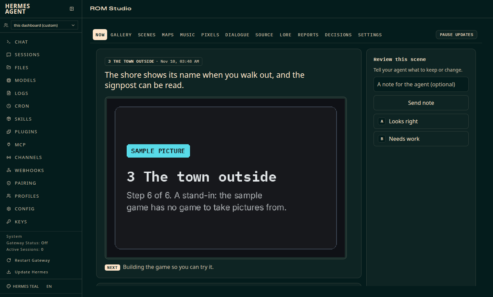

# ROM Studio in Hermes

Watch your game being made without leaving Hermes. Each step your agent takes shows up as a sentence with a picture from the running game. Below it are your answers ("Looks right", "Needs work"), the scenes and a play link. The desktop app shows it in a pane on the right and as a page from the sidebar. The web dashboard shows it as a tab.



## Two-minute start

You need [bun](https://bun.sh), Hermes, and a game folder. `./kit/kit setup` makes one; an empty folder also works, since you can set it up from the pane later.

```sh
./kit/kit plugin install --game ~/my-game
```

Run this from the checkout. Then:

- **Desktop app:** open Capabilities, Plugins, find ROM Studio and switch it on. (The app keeps its own switch for the part it shows.) A ROM Studio row appears in the sidebar, and the pane opens on the right.
- **Web dashboard** (`hermes dashboard`): open the ROM Studio tab.

The page opens a few seconds after the plugin starts. There is no restart, and no `.env` to edit. While the plugin is on, your agent also has the `rom-studio:make-your-game` skill: say "let's make my game".

## Change something

- **Game folder, port, or a page you started yourself:** go to Settings, Plugins, rom-studio in the desktop app. You can also run `hermes config set plugins.entries.rom-studio.settings.game_folder ~/other-game`. Changes take effect within ten seconds.
- **Watch from a phone too:** start the page yourself with `bun pane/server.ts --game ~/my-game --bind 0.0.0.0`. Then put the whole link it prints, key included, in **Pane address**. The plugin shows that page and starts none.

## When something is wrong

The pane says so in a sentence and offers one button to fix it. The cases it covers are: no game folder chosen, the folder missing, bun missing, the port taken by another program, another game's page on that port, and the page stopped. A page the plugin started is started again if it stops, and is stopped when Hermes or the plugin stops. A page you started yourself is never touched.

```sh
./kit/kit plugin status     # linked? switched on? which game? what the pane says now
hermes plugins doctor rom-studio
```

The page's own log is in `<hermes home>/plugin-data/rom-studio/pane.log`. Links with a key are written there with the key hidden.

## Uninstall

```sh
./kit/kit plugin uninstall
```

This removes the link, the plugin's settings and its switch. Your game folder and this checkout are not touched. If ROM Studio was installed some other way (from the catalog or GitHub), `install` and `uninstall` leave it alone and print the Hermes command for it.

Both commands take `--home <folder>` to use a Hermes home other than `~/.hermes`. `install` also takes `--port <n>` and `--pane-url <link>`.

## What does what

- `__init__.py` starts the page on this computer only (127.0.0.1), watches the game's `feed.jsonl` and tells the pane when it changes.
- `dashboard/` holds the web dashboard tab and the one backend route it asks: `/api/plugins/rom-studio/where`.
- `desktop/plugin.js` is the desktop pane and page.
- `common.py` holds the settings, the checks and the sentences shared by all three.

The page itself lives in `pane/`, and the kit's tools in `kit/`. Seen running with Hermes 0.23 on Linux: the web dashboard tab and the desktop workspace (the desktop app's own screens, served by `hermes webapp`). See `CHANGELOG.md`.
